# Fraudes em transações Financeiras

Sistema para detecção de fraudes em pagamentos digitais em escala, utilizando o famoso Paysim. 
A ideia é construir o fluxo do zero, desde a Análise exploratória (EDA), até o deploy do modelo na nuvem.
---

## Resumo Executivo & Resultados

| Indicador / Métrica | Resultado | Impacto Operacional & Negócio |
|---|---|---|
| **Taxa de Captura (Recall - Fraude)** | **99,51%** | 1.226 de 1.232 fraudes interceptadas (apenas 6 transações perdidas). |
| **Precisão (Precision - Fraude)** | **99,92%** | Apenas 1 falso positivo gerado em 414.330 transações idôneas. |
| **F1-Score (Fraude)** | **0,9972** | Equilíbrio ótimo entre mitigação de perdas e volume de alertas. |
| **Taxa de Falsos Alarmes** | **< 0,0003%** | Fila de auditoria manual e atrito com clientes legítimos virtualmente nulos. |

## Problema de Negócio

O objetivo principal do modelo é combater ataques de **Account Takeover (ATO)** com **Evasão Imediata via Contas Laranjas (*Mule Accounts*)**.

Nesse cenário, invasores obtêm acesso não autorizado a contas legítimas (via phishing, malware, SIM swap ou engenharia social) e transferem todo (ou quase todo) o saldo disponível para contas intermediárias sob seu controle (as famosas contas laranjas).

Para driblar o bloqueio preventivo da instituição ou mecanismos de reversão rápida (como o MED no Pix), o fraudador age em minutos: saca a quantia em espécie ou escoa os fundos para fora do sistema tradicional (carteiras digitais, cripto ou afins) antes que a vítima perceba a invasão.

O impacto financeiro escala rápido, gerando prejuízo direto para os cofres da instituição, transtorno severo para a vítima e desgaste direto de confiança na marca. Uma esteira antifraude precisa e automatizada estanca essa sangria em tempo de execução sem gerar atrito com clientes idôneos, transformando solidez operacional em vantagem competitiva.

## Stack Tecnológica

* **Linguagem & Manipulação:** Python, Pandas, NumPy
* **Modelagem & Validação:** XGBoost, Scikit-Learn
* **Explicabilidade (XAI):** SHAP (`TreeExplainer`)
* **Visualização:** Matplotlib, Seaborn
* **Ambiente de Desenvolvimento:** Jupyter Notebook / VS Code
* **API & Servimento:** FastAPI, Pydantic, Uvicorn, Joblib

## Análise Exporatória (EDA) e Feature Engineering

<details>
<summary><b>1. Composição dos Ddados</b></summary>
<br>

| Coluna | Tipo | Descrição de Negócio | Ação no Pipeline |
|---|---|---|---|
| `step` | `int64` | Unidade temporal da simulação (1 step = 1 hora; total de 744 steps / 30 dias). | Utilizado para mapear sazonalidade horária/diária. |
| `type` | `object` | Tipo de movimentação (`PAYMENT`, `TRANSFER`, `CASH_OUT`, `DEBIT`, `CASH_IN`). | Filtrado apenas para `TRANSFER` e `CASH_OUT` (onde ocorrem as fraudes) e convertido via One-Hot Encoding. |
| `amount` | `float64` | Valor monetário transacionado. | Mantido como feature contínua base. |
| `nameOrig` | `object` | Identificador único do cliente de origem (`C...`). | **Descartado:** Identificador com alta cardinalidade para evitar memorização (overfitting). |
| `oldbalanceOrg` | `float64` | Saldo disponível na conta de origem antes da operação. | Utilizado para criar a feature `error_orig`. |
| `newbalanceOrig` | `float64` | Saldo na conta de origem após a operação. | Utilizado para criar a feature `error_orig`. |
| `nameDest` | `object` | Identificador da conta recebedora (`C...` cliente ou `M...` merchant). | **Descartado:** ID de alta cardinalidade sem histórico temporal consolidado no simulador. |
| `oldbalanceDest` | `float64` | Saldo da conta recebedora antes da operação. | Utilizado para criar a feature `error_dest`. |
| `newbalanceDest` | `float64` | Saldo da conta recebedora após a operação. | Utilizado para criar a feature `error_dest`. |
| `isFraud` | `int64` | **Variável Alvo (Target):** `1` para fraude real, `0` para transação idônea. | Target de predição do modelo. |
| `isFlaggedFraud` | `int64` | Regra de negócio legada do simulador (flag em transferências acima de 200k). | **Descartado do treino:** Sistema estático rudimentar do simulador (marca apenas 16 fraudes no dataset inteiro). |

Trata-se de uma base expressiva, com **6.362.620** registros e **11** campos, dos quais **9** são variáveis de entrada, 1 é a variável alvo (`isFraud`) e 1 é um marcador legado (`isFlaggedFraud`).

* **Tipo Categórico:** Apenas o campo **type**.
* **Temporal:** O campo **step**, que atua como marcador de tempo.
* **Numéricos:** Todos os demais são do tipo **int64** ou **float64**.

O campo **isFlaggedFraud** é apenas uma regra legada do simulador, portanto não tem relevância para a modelagem e foi descartado.

<details>
<summary><b>Entendimento do Campo Step & Engenharia Temporal</b></summary>
<br>

O campo `step` mapeia o contador de tempo da simulação, onde cada incremento representa **1 hora** transcorrida. O intervalo vai de 1 a 743 (744 horas), cobrindo exatamente **31 dias** de operações.

Apesar de ser um contador linear contínuo, ele carrega sazonalidades implícitas que revelam padrões comportamentais entre clientes legítimos e fraudadores. A partir dele, derivei três variáveis temporais para enriquecer o modelo:

---

### 1. `hour` (Hora do Dia: 0 a 23)

Avalia o ciclo circadiano das transações via operador de resto (`step % 24`).

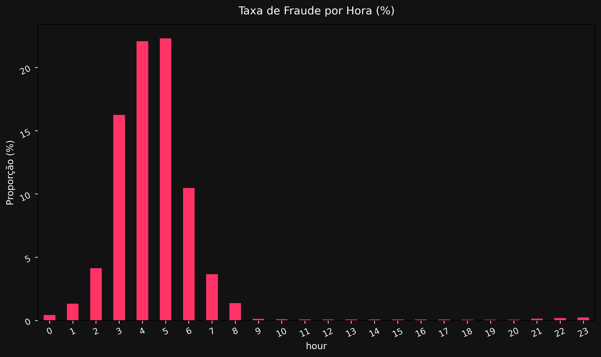

* **Insight:** Há uma concentração nítida de ataques durante a madrugada, com pico crítico entre 4h e 5h da manhã — horários que, somados, concentram cerca de 40% das ocorrências fraudulentas. Enquanto clientes idôneos estão inativos, atacantes e scripts automatizados operam para atrasar a percepção da vítima.
* **Decisão:** Variável mantida no modelo final como preditor de risco operacional.

---

### 2. `day_of_week` (Dia da Semana: 0 a 6)

Avalia se o comportamento do fraudador varia conforme a rotina semanal bancária (`(step // 24) % 7`).

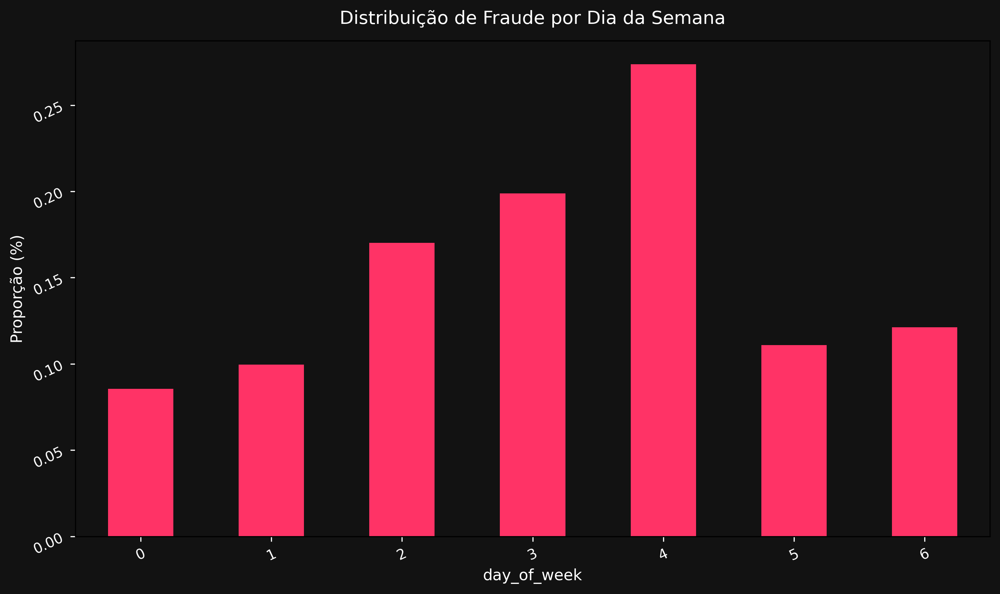

* **Insight:** A distribuição mostrou-se homogênea ao longo dos dias, com uma leve acentuação nas quartas-feiras. No entanto, a taxa de fraude em relação ao volume de operações legítimas não ultrapassou 1% em nenhum dia específico.
* **Decisão:** Variável **descartada** do treinamento para evitar ruído estatístico e reduzir a dimensionalidade sem perda de poder preditivo.

---

### 3. `day_of_month` (Dia da Simulação: 1 a 31)

Mapeia a distribuição temporal ao longo de todo o mês de histórico (`step // 24`).

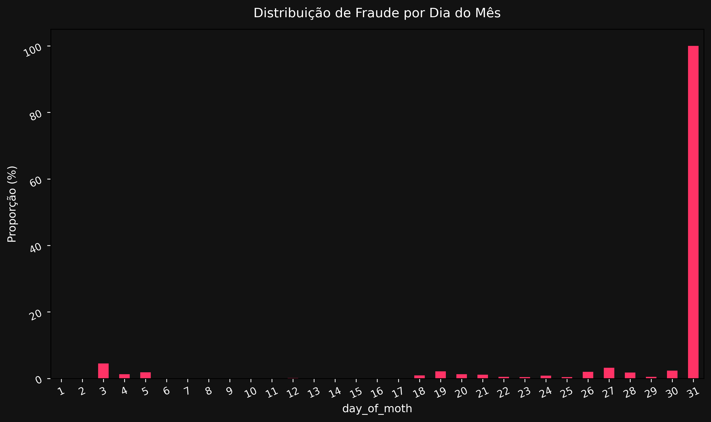

* **Insight:** Identifica-se uma anomalia severa no primeiro dia da simulação, onde a taxa de incidentes fraudulentos é desproporcionalmente dominante. 
* **Decisão & Ressalva:** Esse comportamento reflete uma particularidade do gerador sintético do PaySim (onde agentes maliciosos iniciam ataques logo no setup da simulação) e não necessariamente um padrão de comportamento humano real. A variável entrega alto ganho de informação para o modelo neste ambiente, mas sua relevância deve ser monitorada de perto contra *overfitting* sintético em dados reais de produção.

</details>

<details>
<summary><b>Compreensão da Variável Categórica (Type)</b></summary>
<br>

A base contempla 5 modalidades distintas de transação: `CASH_IN`, `CASH_OUT`, `DEBIT`, `PAYMENT` e `TRANSFER`.

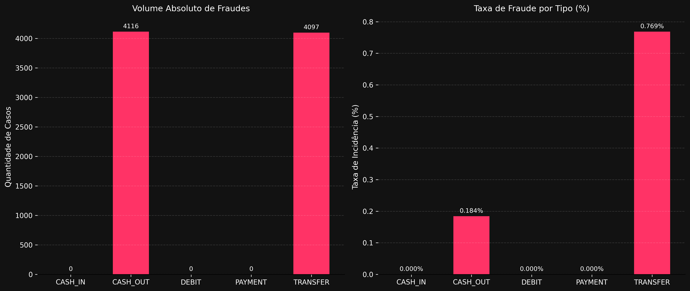

* **Insight:** Duas constatações são imediatas: o desbalanceamento severo da base e a **ausência absoluta de fraudes** em `CASH_IN`, `DEBIT` e `PAYMENT`. 100% dos eventos fraudulentos concentram-se estritamente em `TRANSFER` (exfiltração inicial) e `CASH_OUT` (liquidação imediata).
* **Decisão de Engenharia:** A base foi filtrada para processar **apenas** `TRANSFER` e `CASH_OUT`. Manter as demais categorias apenas geraria custo computacional desnecessário e inflaria a acurácia de forma artificial com milhões de verdadeiros negativos triviais. A variável `type` foi mantida no modelo (via One-Hot Encoding) como indicador de risco da etapa da transação.

</details>

<details>
<summary><b>Investigação das Variáveis Numéricas de Balanço</b></summary>
<br>

#### 1. `amount` (Montante Transacionado)

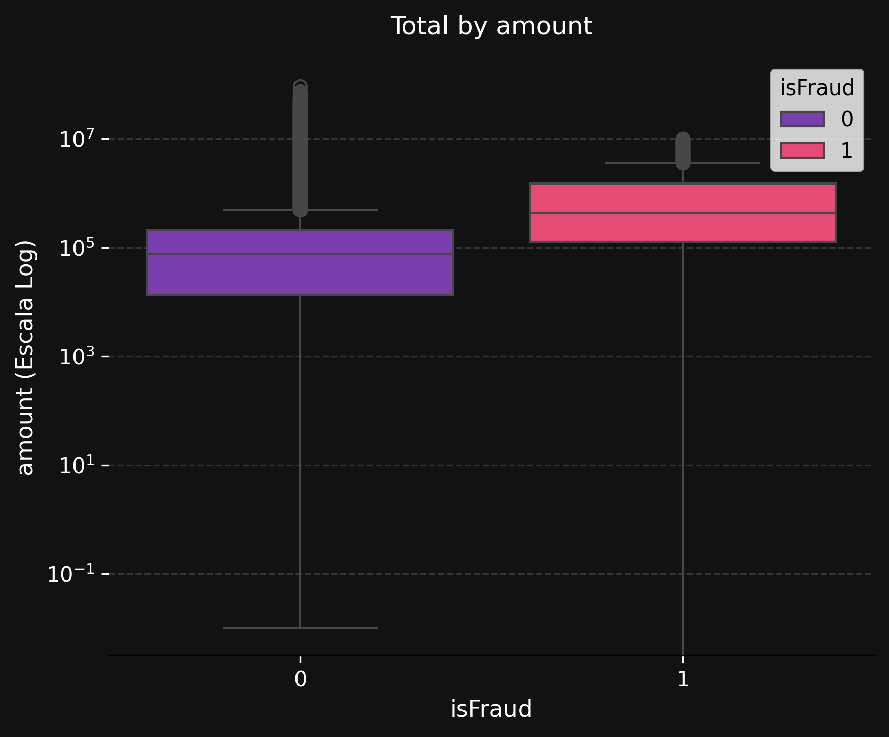

* **Insight:** Transações fraudulentas concentram-se em volumes financeiros substancialmente maiores. A mediana e o intervalo interquartil (IQR) das fraudes situam-se em patamares mais elevados em relação às operações idôneas. Ao mesmo tempo, os maiores *outliers* absolutos pertencem a transações legítimas, indicando que os atacantes evitam quantias exorbitantes fora dos padrões do sistema para não disparar regras estáticas imediatas de corte.
* **Decisão:** Variável **mantida**. O valor nominal é um preditor de risco relevante, especialmente quando ponderado contra os saldos das contas.

---

#### 2. `oldbalanceOrg` e `newbalanceOrig` (Dinâmica de Saldo na Origem)

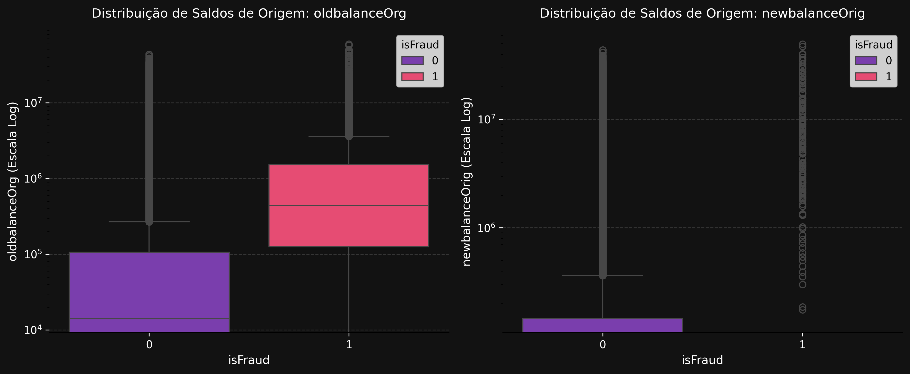

* **Insight:** Enquanto clientes idôneos realizam transações rotineiras preservando reservas na conta, as fraudes apresentam o padrão clássico de esvaziamento forçado: o saldo final da vítima converge sistematicamente para zero (`newbalanceOrig == 0`). O atacante busca transferir o teto máximo permitido do saldo disponível.
* **Decisão:** Variáveis **mantidas** e utilizadas como matéria-prima direta para a criação da variável contábil `error_orig`.

---

#### 3. `oldbalanceDest` e `newbalanceDest` (Dinâmica de Saldo no Destino)

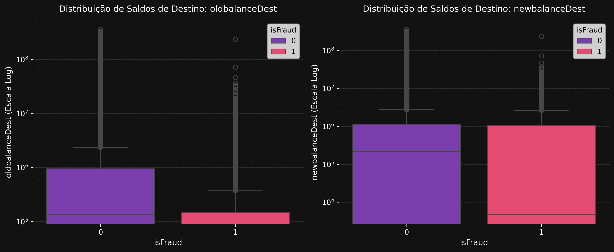

* **Insight:** Nas operações fraudulentas, as contas recebedoras (*mules* ou intermediárias) iniciam predominantemente com saldo anterior zerado ou muito baixo (`oldbalanceDest == 0`), padrão típico de contas recém-alugadas ou criadas exclusivamente para evasão. Pós-transação, a mediana reflete o acúmulo repentino do capital drenado antes do saque/liquidação.
* **Decisão:** Variáveis **mantidas** e combinadas na variável `error_dest` para capturar inconsistências no recebimento.

</details>

<details>
<summary><b>Engenharia de Features Contábeis (O Ponto de Virada)</b></summary>
<br>

Modelos que analisam apenas os valores brutos (`amount`, saldos antes e depois) enfrentam dificuldades para distinguir uma transferência legítima de alto valor de um golpe real. 

A quebra da lógica contábil da transação é o sinal mais forte de fraude no PaySim. Em operações financeiras normais, a equação de balanço deve fechar:

$$\text{Saldo Final} = \text{Saldo Anterior} \pm \text{Montante}$$

Com base nisso, formulei duas variáveis de **inconsistência de balanço**:

---

#### 1. Discrepância na Origem (`error_orig`)
Calcula a divergência entre o débito esperado e a alteração real no saldo da vítima:

$$\text{error_orig} = \text{newbalanceOrig} + \text{amount} - \text{oldbalanceOrg}$$

* **Comportamento Idôneo:** O valor tende a **0** (o débito bate exatamente com o valor transferido).
* **Comportamento Fraudulento:** Assume valores atípicos. Como o fraudador frequentemente tenta transferir quantias maiores do que o saldo total da vítima, o saldo zera mas a conta matemática não fecha.

---

#### 2. Discrepância no Destino (`error_dest`)
Calcula a divergência entre o crédito esperado e o saldo registrado na conta recebedora (*mule*):

$$\text{error_dest} = \text{oldbalanceDest} + \text{amount} - \text{newbalanceDest}$$

* **Comportamento Idôneo:** O valor tende a **0** (o saldo sobe exatamente na proporção da quantia recebida).
* **Comportamento Fraudulento:** Valores muito elevados ou anômalos. Em ataques orquestrados, a conta laranja costuma ter saldo final registrado como zero ou inconsistente devido ao saque imediato (`CASH_OUT`) em fração de segundos.

---

**Impacto no Pipeline:** Essas duas variáveis sintetizam o comportamento da fraude em métricas matemáticas diretas, aliviando a complexidade das árvores de decisão do XGBoost e eliminando a dependência de regras condicionais estáticas frágeis.

</details>


</details>

<details>
<summary><b>Pré-processamento & Estratégia de Validação</b></summary>
<br>

Para garantir generalização sem vazamento de dados (*data leakage*), o pipeline de preparação seguiu critérios estritos:

1. **Remoção de Identificadores de Alta Cardinalidade:**
   * As colunas `nameOrig` e `nameDest`foram removidas devido à altíssima cardinalidade e por atuarem puramente como identificadores de conta. A ideia é que o modelo aprenda padrões comportamentais de transações fraudulentas em vez de apenas "decorar" contas específicas, evitando *overfitting*.
2. **Tratamento Categórico:**
   * Aplicação de One-Hot Encoding na variável `type` (restrita a `TRANSFER` e `CASH_OUT`).
3. **Divisão Estratificada (Train / Test Split):**
   * Devido à proporção minoritária das fraudes, a divisão foi feita mantendo a estratificação (`stratify=y`) para preservar a exata taxa de fraude em ambos os conjuntos, evitando vieses.
   * **Base de Teste:** 415.562 transações idôneas e 1.232 transações fraudulentas mantidas completamente isoladas para a validação final.

</details>

<details>
<summary><b>Modelagem com XGBoost & Ajuste de Parâmetros</b></summary>
<br>

### 1. Por que o XGBoost se destaca em dados tabulares financeiros?

Modelos baseados em árvores com aumento de gradiente (*Gradient Boosted Decision Trees - GBDT*) continuam sendo a referência para dados tabulares estruturados no setor bancário por vantagens práticas:

* **Mapeamento de Não-Linearidades e Interações:** O XGBoost cria árvores sequenciais focadas nos resíduos dos erros anteriores. Isso permite capturar interações complexas entre variáveis contábeis (por exemplo: a combinação de um `error_orig` atípico com um horário específico da madrugada) sem necessidade de transformações polinomiais manuais.
* **Robustez a Outliers e Escalas:** Transações financeiras possuem distribuição de cauda longa (*heavy tail*) com valores discrepantes. Árvores tomam decisões por particionamento de espaço (divisão por limiares), tornando o modelo imune a distorções de escala que prejudicariam modelos lineares ou redes neurais sem padronização extrema.
* **Velocidade de Inferência:** Baixa latência computacional em predição, viabilizando o uso do modelo em esteiras de tempo real pré-autorização.

---

### 2. Implementação & Configuração do Estimador

A instanciação do modelo no pipeline seguiu a configuração:

```python
from xgboost import XGBClassifier

# Cálculo da razão exata entre classes majoritária e minoritária no treino
scale_weight = (len(y_train) - y_train.sum()) / y_train.sum()


xgb = XGBClassifier(
    scale_pos_weight=scale_weight,
    eval_metric='logloss',
    random_state=42,
    n_jobs=-1,
)

```

### Justificativa dos Hiperparâmetros do Modelo

* **`scale_pos_weight = scale_weight` (~336x):**
  * **O Cálculo:** A relação $\frac{\text{total negativos}}{\text{total positivos}}$ define a taxa real de desbalanceamento na partição de treino. No recorte analítico (`TRANSFER` e `CASH_OUT`), a proporção observada é de aproximadamente 1 fraude para cada 336 transações idôneas.
  * **Objetivo de Negócio:** Em esteiras antifraude bancárias, a perda por falso negativo (fraude consumada, estorno e risco reputacional) é substancialmente mais gravosa do que uma checagem preventiva. A ponderação força o gradiente a punir a omissão de transações maliciosas com severidade amplificada.
  * **Por que a precisão não colapsou:** Em bases com alto nível de ruído, pesos dessa magnitude costumam gerar disparos excessivos de falsos alarmes. No entanto, o modelo sustentou **99,92% de precisão** (apenas 1 falso positivo em mais de 414 mil transações legítimas avaliadas). O resultado valida a eficácia da engenharia contábil: o sinal provido por `error_orig` e `error_dest` entrega separabilidade tão nítida que o algoritmo intercepta **99,51% dos ataques** sem gerar atrito na esteira de aprovação legítima.

* **`eval_metric='logloss'`:**
  * Minimiza a perda logarítmica direta sobre as probabilidades preditas em vez de calibrar por métricas discretas estáticas, garantindo estimativas contínuas e calibradas de probabilidade de risco por transação.

* **`random_state=42` & `n_jobs=-1`:**
  * Garante reprodutibilidade integral de splits e amostragem de árvores, combinada com paralelização em todos os núcleos da CPU para máxima eficiência computacional.


</details>

#<details>
<summary><b>API de Inferência (FastAPI)</b></summary>
<br>

O modelo salvo (`artifacts/xgb_fraud_model.joblib`) e o esquema de colunas (`artifacts/feature_cols.json`) são expostos via REST em `app/main.py`.

### Contrato de Entrada e 12 Features
O `TransactionPayload` valida os campos com Pydantic e normaliza `type` (`strip().upper()`). A função `build_features_df` monta o `DataFrame` com as 12 features alinhadas a `artifacts/feature_cols.json`:
- **Base:** `step`, `amount`, `oldbalanceOrg`, `newbalanceOrig`, `oldbalanceDest`, `newbalanceDest`
- **Temporais:** `hour` (`step % 24`), `day_of_month` (`step // 24`)
- **Contábeis e flags:** `error_orig`, `error_dest`, `dest_zero_flag`, `type_TRANSFER`

### Endpoints
- `GET /`: instruções, tipos suportados e exemplo de payload.
- `GET /status`: estado do serviço e confirmação de `model_loaded`.
- `POST /predict`: pontua `TRANSFER` e `CASH_OUT` (`status: "scored"`, `fraud_probability`, `is_fraud` com `THRESHOLD = 0.5`) e marca `PAYMENT`, `CASH_IN` e `DEBIT` como `status: "out_of_scope"` (`fraud_probability: null`, `is_fraud: null`).

</details>

<details>
<summary><b>Avaliação de Performance & Análise de Erros</b></summary>
<br>

A avaliação foi conduzida sob a métrica primária **PR-AUC (Precision-Recall)**, já que o ROC-AUC é distorcido pelo volume massivo de verdadeiros negativos.

### 1. Curva Precision-Recall
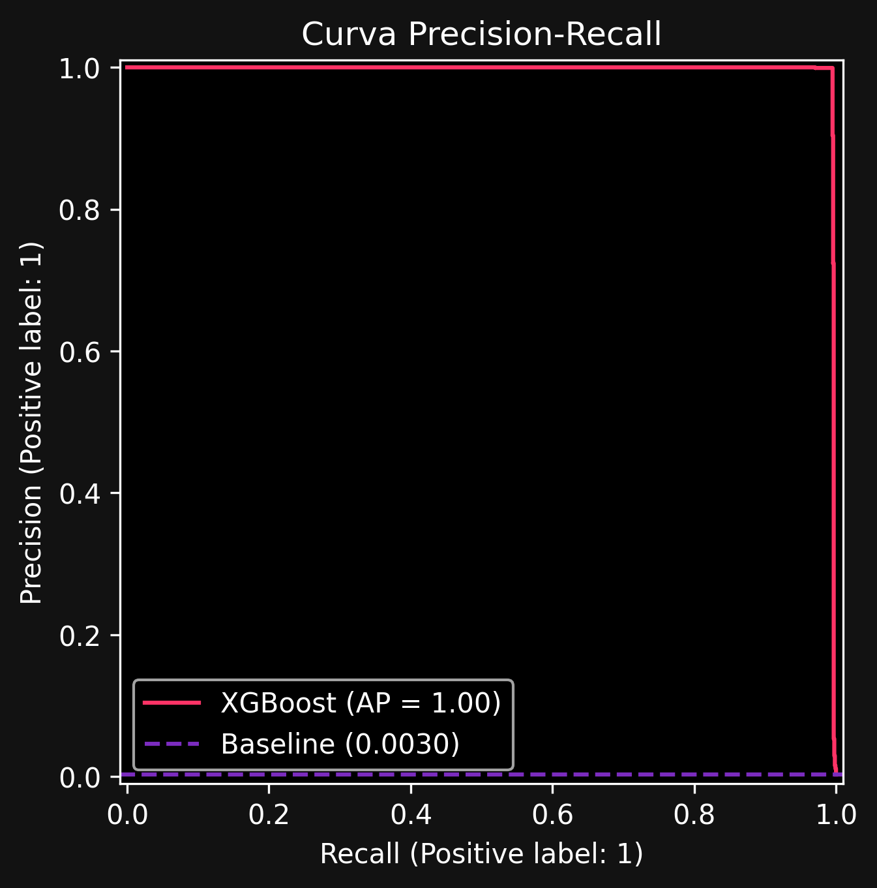

* A curva sustenta um patamar quase reto no topo direito, demonstrando que o algoritmo consegue atingir recall altíssimo sem sacrificar a precisão.

### 2. Matriz de Confusão (Partição de Teste)
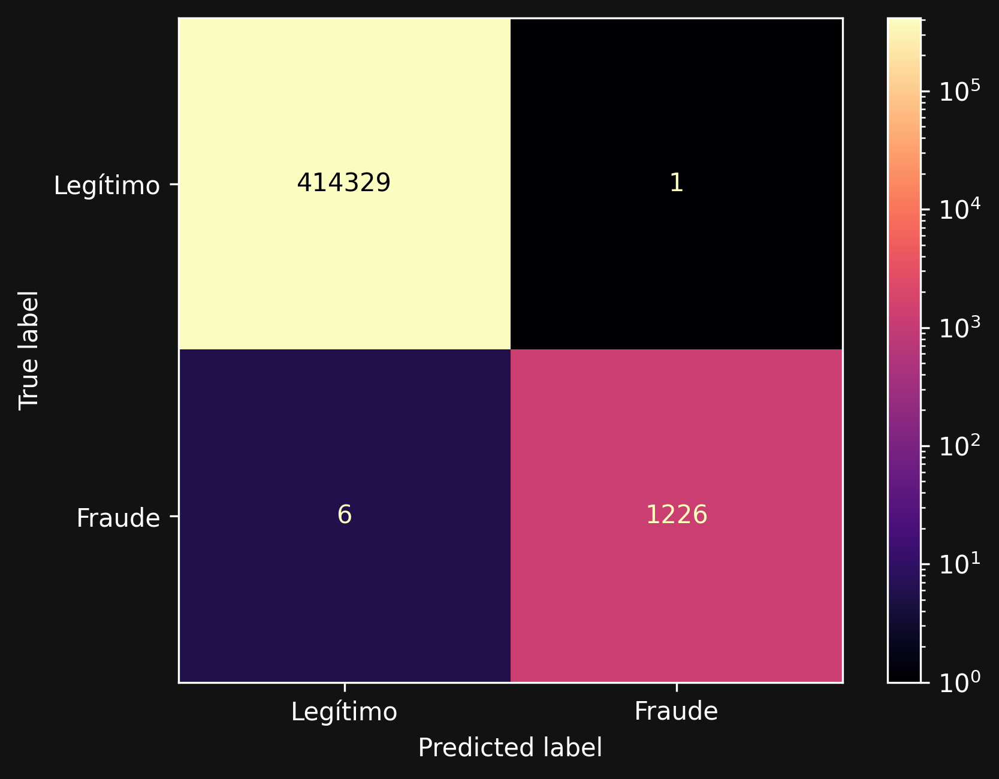

* **Verdadeiros Positivos (1.226):** 99,51% das fraudes interceptadas.
* **Falsos Negativos (6):** Apenas 6 fraudes passaram pelo filtro, reduzindo a exposição financeira direta a uma fração mínima.
* **Falsos Positivos (1):** Somente 1 transação legítima em 414.330 foi sinalizada erroneamente, garantindo que clientes idôneos transacionem sem atrito indevido.
* **Verdadeiros Negativos (414.329):** Operação legítima fluindo com normalidade.

</details>

<details>
<summary><b>Explicabilidade do Modelo com SHAP (Explainable AI - XAI)</b></summary>
<br>

Em ambientes bancários e fintechs, modelos do tipo "caixa-preta" enfrentam barreiras regulatórias e operacionais severas. Uma esteira antifraude precisa ser **auditável**: mesas de risco, compliance e órgãos reguladores exigem saber exatamente *por que* uma transação foi interrompida.

Para decompor as decisões do XGBoost, utilizei a biblioteca **SHAP (SHapley Additive exPlanations)** com o algoritmo otimizado `TreeExplainer`, avaliando o impacto das variáveis em nível global e individual.

---

### 1. Visão Global: Importância e Direção das Variáveis (Summary Plot)

O gráfico de resumo consolida o peso de cada variável e a direção do seu impacto no cálculo da probabilidade de fraude.

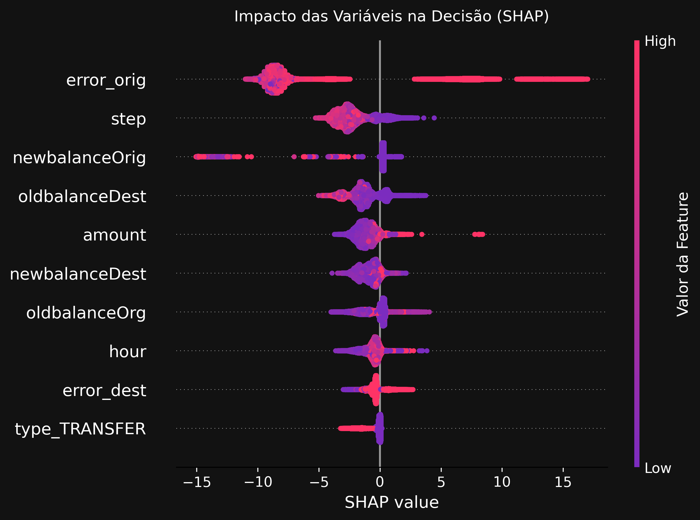

* **Supremacia das Features Contábeis:** As variáveis derivadas `error_orig` e `error_dest` assumiram o topo absoluto de importância preditiva, superando amplamente as métricas brutas fornecidas originalmente pelo PaySim.
* **Sentido do Impacto:**
  * **Alto valor de `error_orig` (pontos vermelhos à direita):** Forte empurrão para a classificação de fraude. Mostra a quebra contábil direta entre o valor retirado e a redução real na conta da vítima.
  * **Comportamento em `error_dest`:** Anomalias no saldo da conta de passagem aumentam substancialmente o risco de a transação ser sinalizada como evasão via conta laranja (*mule account*).
* **Validação do Modelo:** O algoritmo aprendeu causalidade contábil sólida em vez de correlacionar ruído estático de horários ou volumes isolados.

---

### 2. Visão Local: Auditoria de Bloqueio Individual (Waterfall Plot)

Para auditar um caso real interceptado pelo modelo, analisamos a decomposição passo a passo de uma única transação fraudulenta.

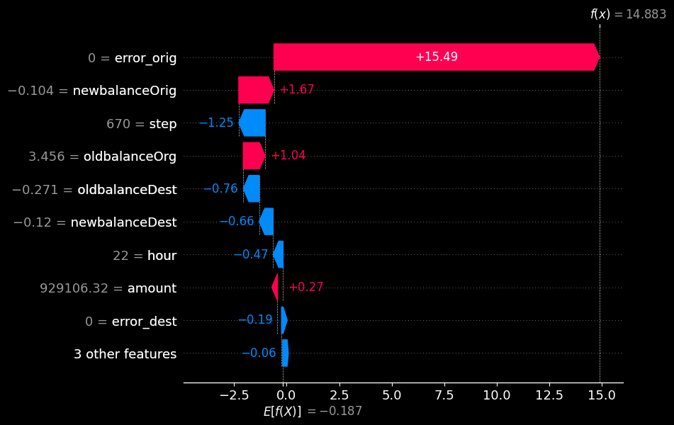

* **Linha de Base ($E[f(X)]$):** Representa a probabilidade esperada média do modelo no conjunto de dados (cenário padrão, onde a maioria esmagadora é legítima).
* **Contribuições Passo a Passo:**
  * O desvio em `error_orig` é o primeiro grande vetor de empurrão (+valor), tirando a transação da neutralidade e aproximando-a da faixa de alerta.
  * A ausência de equilíbrio em `error_dest` consolida a probabilidade final bem acima do limiar de corte (*threshold*).
* **Utilidade Operacional:** Esse detalhamento permite que um analista de risco veja em segundos o motivo do bloqueio automático no painel de monitoramento, agilizando o suporte ao cliente sem comprometer a segurança.

</details>

<details>
<summary><b>Impacto de Negócio & Posicionamento Estratégico</b></summary>
<br>

Em instituições financeiras, a eficácia de uma esteira antifraude não se mede apenas por métricas estatísticas isoladas, mas pelo equilíbrio entre preservação de capital, custo operacional e experiência do usuário:

* **Mitigação Direta de Perdas (Recall 99,51%):** Das 1.232 fraudes no conjunto de teste, 1.226 foram bloqueadas antes da liquidação financeira. Como os ataques simulados baseiam-se na drenagem completa de fundos de contas vulneráveis, o modelo impede o prejuízo patrimonial direto da instituição e os custos associados a chargebacks, disputas judiciais e indenizações.
* **Experiência sem Fricção (Precisão 99,92%):** Apenas 1 falso positivo em 414.330 transações legítimas avaliadas. Esse índice elimina o principal gargalo de soluções antifraude legadas: o bloqueio indevido de clientes idôneos (*false decline*), que gera churn imediato e sobrecarrega a mesa de análise manual com chamados de suporte.
* **Diferencial Competitivo no Setor Bancário:** Enquanto instituições tradicionais operam com motores de regras rígidos, lentos e suscetíveis a altas taxas de falso alarme, a integração de modelos probabilísticos de alta precisão permite autorizações instantâneas e seguras no checkout. A segurança invisível torna-se um diferencial de retenção e confiabilidade.
* **Evolução para um Banco Tecnológico:** A adoção de inteligência analítica com explicabilidade (XAI) consolida a transição de um modelo bancário reativo para uma postura orientada a dados e engenharia de software avançada. A esteira substitui heurísticas manuais por automação escalável, posicionando a infraestrutura da instituição na vanguarda da segurança digital.

</details>

<details>
<summary><b>Próximos Passos & Evolução da Arquitetura</b></summary>
<br>

Para elevar a solução a um ambiente produtivo de nível corporativo, o roadmap técnico contempla os seguintes desenvolvimentos:

### 1. Conteinerização & Deploy (Docker / Nuvem)
- Empacotamento da API em FastAPI (`app/main.py`) e artefatos (`artifacts/`) em imagem Docker para execução reproduzível em qualquer ambiente ou nuvem.

### 2. Camada Não Supervisionada para Monitoramento Integral
* **Superação do Filtro Categórico:** O modelo supervisionado atual foi restrito a `TRANSFER` e `CASH_OUT` por serem as únicas classes com rótulos positivos no histórico sintético. No entanto, descartar transações como `PAYMENT`, `DEBIT` e `CASH_IN` em produção geraria pontos cegos contra novas tipologias de fraude (como lavagem de dinheiro, contas de passagem e ataques pulverizados / *smurfing*).
* **Arquitetura Híbrida:** Integração de um modelo não supervisionado (como Isolation Forest, Autoencoders ou One-Class SVM) operando em paralelo. Esse modelo analisará a totalidade dos campos e tipos de transação sem depender de rótulos prévios, sinalizando desvios comportamentais atípicos e ataques de dia zero (*zero-day frauds*) para retroalimentar a esteira supervisionada.

### 3. Monitoramento Contínuo (MLOps)
* Implementação de rotinas de detecção de *Data Drift* e *Concept Drift*, garantindo que alterações sazonais no comportamento de consumo ou novas táticas de invasores disparem alertas de retreinamento automático.
* Integração com Feature Store para garantir consistência entre as variáveis calculadas no treinamento e na inferência online.

</details>

<details>
<summary><b>Como Reproduzir o Projeto</b></summary>
<br>

### Pré-requisitos
- Python 3.10 ou superior
- Git

### Execução Local da API (FastAPI)
1. Na raiz do projeto, garanta `app/__init__.py`, `app/main.py`, `artifacts/xgb_fraud_model.joblib` e `artifacts/feature_cols.json`.
2. Suba o servidor com Uvicorn:
   ```bash
   uvicorn app.main:app --reload
   ```
3. Acesse http://127.0.0.1:8000/docs ou envie requisições pelo predict.http.
   
### Execução via Colab

1. Acesse o notebook no diretório notebooks/.

2. Abra o arquivo .ipynb no Google Colab ou importe-o em uma sessão do Kaggle.

<<<<<<< HEAD
O desenvolvimento e a experimentação foram conduzidos diretamente em ambiente de nuvem (Google Colab / Kaggle) devido à volumetria de dados e aceleração de hardware.

### Execução via Google Colab / Kaggle
1. Acesse o notebook no diretório [`notebooks/`](notebooks/).
2. Abra o arquivo `.ipynb` no [Google Colab](https://colab.research.google.com/) ou importe-o em uma sessão do Kaggle.
3. O download da base é feito de forma programática via `kagglehub`, dispensando o envio manual de chaves ou credenciais de API (`kaggle.json`):
   ```python
   import kagglehub
   path = kagglehub.dataset_download("mtalaltariq/paysim-data")
   ``
=======
3. O download da base é feito de forma programática via kagglehub, dispensando o envio manual de chaves ou credenciais de API (kaggle.json):
```python
import kagglehub
path = kagglehub.dataset_download("mtalaltariq/paysim-data")
```
>>>>>>> e1a091d (small changes in readme)
